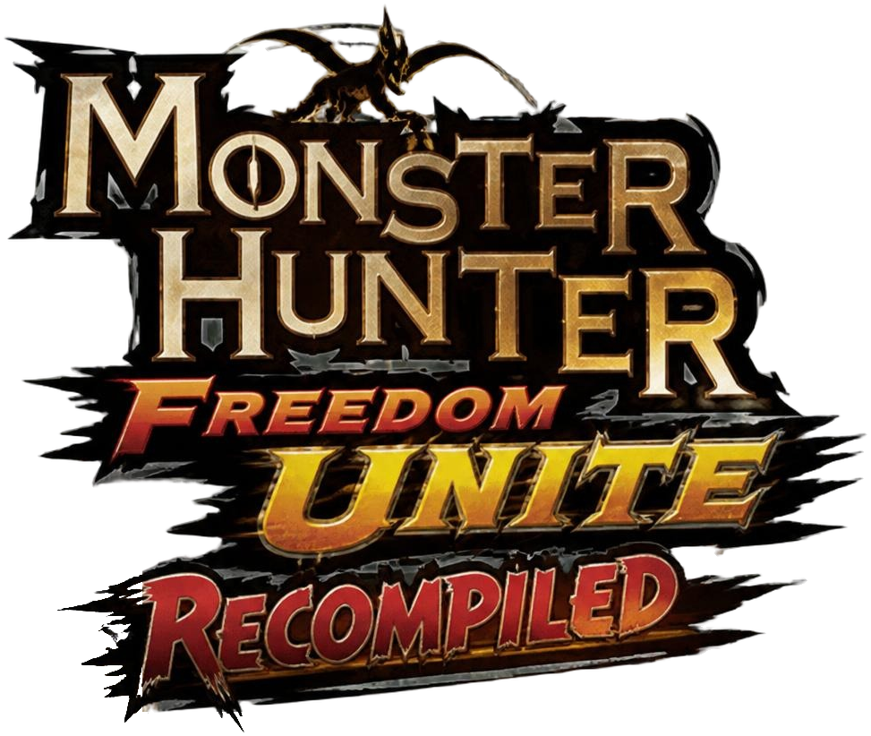

<p align="center">
  
</p>

<p align="center">
  <strong>A work-in-progress native port of <em>Monster Hunter Freedom Unite</em>, made through static recompilation.</strong>
</p>

<p align="center">
  Linux &middot; EU release (<code>ULES01213</code> v1.01) &middot; Early playable
</p>

# Monster Hunter Freedom Unite Recompiled

MHFU Recomp translates the PSP executable for **Monster Hunter Freedom Unite** into C++ on your own machine, then runs it with native implementations of the PSP services the game needs. It is not a conventional emulator: the game code is compiled ahead of time for your computer, while an interpreter remains available only as a fallback for code that has not been translated.

The project is currently a **Linux-first prototype**. It can boot, create a hunter, play the opening, enter the village, run quests, save progress, and play online with compatible PPSSPP players. Expect rough edges while development continues.

> **You need your own legally obtained European copy of Monster Hunter Freedom Unite** — release `ULES01213`, version 1.01 — dumped from your UMD as an ISO. Other regions and revisions are not supported yet, and neither are compressed images (`.cso`, `.chd`): use a plain `.iso`.

## Legal disclaimer

**MHFU Recomp** is an independent fan-made compatibility, interoperability, and research project. It is not affiliated with, authorized by, sponsored by, or endorsed by CAPCOM, Sony, or any of their affiliates.

*Monster Hunter Freedom Unite*, *Monster Hunter*, CAPCOM, PlayStation, PSP, and all associated names, game assets, artwork, audio, video, characters, and trademarks are the property of their respective owners. References to them are used only to identify the software with which this project is intended to interoperate. The launcher's logo is fan artwork made for this project in the style of the game's; it is not an official CAPCOM logo.

This project provides a recompilation framework and independently written support code; it is **not the game**, and this repository contains no game code or data. To play, you must supply files from a copy of *Monster Hunter Freedom Unite* that you obtained lawfully and may use under the laws that apply to you. This project does not support, provide, link to, or encourage unauthorized copies of the game.

Before publishing a fork, release, or build, remove and do not redistribute any proprietary game content: ISO images, executables, asset archives, extracted files, saves containing game assets, or generated output derived from them — including a built `mhfu` binary, which contains the translated game code, and the decompiled code the research tools produce. The project's own license applies only to original project code and materials; it does not grant rights in any third-party game content.

## Current status

| Available now | Still in progress |
| --- | --- |
| Booting, menus, character creation, village, quests, saving and loading | Native Windows and Android builds |
| Native SDL2 + OpenGL ES renderer at 720p or 1080p | PSP-style system save/load dialogs (accepted automatically for now) |
| Music, sound effects, and video playback (with FFmpeg) | Further audio testing and polish |
| 30 fps or an optional true 60 fps mode | The game's downloadable event-quest service |
| Optional frame interpolation | Broader hardware and distribution testing |
| Keyboard and controller support; the launcher also works with a mouse | |
| Free right-stick camera in hunting areas | |
| Optional hold-to-gather quality-of-life feature | |
| Online ad-hoc multiplayer, including PPSSPP compatibility | |

## Play

### Requirements

- A Linux PC, or Windows through WSL
- Your own MHFU EU (`ULES01213` v1.01) ISO
- Disk space for the build and a copy of the game's data (about 750 MB)
- An internet connection on first run, to install build packages and fetch the recompiler

`play.sh` installs missing build packages with apt, pacman, dnf, or zypper, after asking for your password. It needs a C++ compiler (g++ 13 or newer), SDL2, OpenGL ES headers, Python 3, the Liberation fonts, and FFmpeg for video playback (optional: without it, the videos are skipped).

```sh
git clone https://github.com/kevin11dev/MHFU-Recomp.git
cd MHFU-Recomp
./play.sh
```

On first launch, `play.sh` finds your ISO or lets you choose its folder, downloads and builds the recompiler, translates the game executable from your ISO, copies the game's data into `~/.local/share/mhfu-recomp`, and starts MHFU. This takes a few minutes. Later launches reuse that build and rebuild only when the project changes.

To find your ISO, it looks where emulators keep games: PPSSPP's recent games and the folder it showed last, and `roms`, `Games`, `Emulation` (EmuDeck), `retrodeck`, and `Downloads` folders in your home folder or on a memory card. If it isn't there, it asks for the folder, using `zenity` or `kdialog` (or the terminal without either), and searches that folder and the folders in it. It recognizes the game by what's on the disc, not the file name, and tells you what it found if your copy doesn't match (another region, a modified copy, a compressed image).

| Command | What it does |
| --- | --- |
| `./play.sh` | Find the ISO if needed, build, then open the launcher |
| `./play.sh --play` | Start the game directly, skipping the launcher |
| `./play.sh /path/to/game.iso` | Use a particular ISO |
| `./play.sh /path/to/roms` | Search a ROM folder for the supported ISO |
| `./play.sh --choose-iso` | Choose the ISO folder again |

Saves live in the game data directory at `~/.local/share/mhfu-recomp/ms0`, and the launcher's settings in `config.txt` next to it.

### SteamOS, Bazzite, and Windows

Immutable Linux distributions cannot install build tools directly. Create an Ubuntu distrobox first:

```sh
distrobox create -i ubuntu:24.04 -n mhfu
distrobox enter mhfu
```

Then run the commands above inside that container. On Windows, run `wsl --install` in PowerShell, restart, open the Ubuntu terminal, and run the Linux steps there. Your Windows drives are available under `/mnt/c`, so the ISO can stay where it is.

## Controls

| PSP control | Keyboard | Controller |
| --- | --- | --- |
| D-pad | Arrow keys | D-pad |
| Analog stick | W A S D | Left stick |
| Camera in hunting areas | Arrow keys | Right stick or D-pad |
| `✕` `○` `□` `△` | K L J I | A B X Y |
| L / R | Q / E | Shoulder buttons |
| Start / Select | Enter / Right Shift | Start / Back |

The launcher contains the full controls screen and settings for display mode, resolution, frame rate, interpolation, the right-stick camera, hold-to-gather, and multiplayer. Each optional feature is off until you turn it on, so you can also play the original way. If something moves too fast or behaves oddly at 60 fps, try 30.

## Multiplayer

MHFU Recomp supports the PSP game's ad-hoc multiplayer over public relay servers. It can play alongside PPSSPP 1.20 or newer, and PSPs with the aemu plugin, when every player selects the same server.

1. Open **Settings** in the launcher and choose a multiplayer server that is online.
2. Everyone who wants to play together selects that same server.
3. In the village, go to the Gathering Hall's door and press **○** to go in with others (**□** goes in alone).
4. Choose the same hall number as your friends.

The service is community-run, so availability can change. If no server answers, joining a hall gives up with a communication error after about 10 seconds; try another listed server and confirm that all players are using the same selection.

## How it works

MHFU Recomp builds on [psprism](https://github.com/anthonyhfm/psprism), a PSP static recompilation framework. It translates the game's Allegrex CPU code into C++, compiles that code locally, and supplies a native PSP runtime for threads, disc I/O, graphics, audio, fonts, save data, video, input, and networking.

This repository adds the MHFU-specific pieces: fixes to the translator, the title's code map, a Linux SDL2/OpenGL ES host, a launcher, font and timer support, video and audio fixes, online ad-hoc networking, an enhanced camera, and optional gameplay features. The build takes the game's program from the ISO you provide, checks it against the version this project is made for, and the game reads its data from your copy as it runs; none of it is fetched by the build system.

Technical notes are in [recomp/README.md](recomp/README.md), and the reverse-engineering workflow is documented in [docs/decompilation.md](docs/decompilation.md).

## Repository guide

| Path | Purpose |
| --- | --- |
| `play.sh` | Finds a compatible ISO, builds the project, and starts the game |
| `recomp/` | Native host code, psprism patch, build scripts, launcher, and features |
| `re/` | Function names, signatures, structures, and reverse-engineering notes |
| `tools/` | Ghidra automation, overlay extraction, and layout-generation tools |
| `docs/` | Recompilation and feature-development documentation |
| `symbols/` | PSP import and overlay metadata |

The research tools write the game's program, its overlays, and a Ghidra decompilation (`decompiled/`) into the repository folder on your computer, from your own copy; those paths are git-ignored and are not part of the repository. None of them are needed to play.

To work on the native port, start with [`recomp/README.md`](recomp/README.md). [`docs/features.md`](docs/features.md) explains how optional gameplay features are implemented and exposed as launcher settings.

## Contributing

Bug reports, compatibility testing, and reverse-engineering findings are welcome. When reporting an issue, include your Linux distribution, graphics hardware and driver, the launcher settings you use (frame rate, frame interpolation, right-stick camera), and clear steps to reproduce the problem. The terminal output from `./play.sh` helps too.

Please do not upload, attach, or commit any game ISO, executable, asset archive, extracted game data, decompiled game code, or save containing proprietary game content.

## Credits

- [psprism](https://github.com/anthonyhfm/psprism) (GPL-3.0) — PSP static recompilation framework and native runtime
- [PPSSPP](https://www.ppsspp.org/) and [pspautotests](https://github.com/hrydgard/pspautotests) — PSP behavior and font-metric reference material
- [aemu_postoffice](https://github.com/Kethen/aemu_postoffice) (GPL-3.0) and [ENet](https://github.com/zpl-c/enet) (MIT) — ad-hoc multiplayer protocol support; thanks to the people who run the public servers
- [stb](https://github.com/nothings/stb) — image and font support
- [CWCheat Database Plus](https://github.com/Saramagrean/CWCheat-Database-Plus-) — basis for the 60 fps patch
- [Liberation Fonts](https://github.com/liberationfonts) and [Cinzel](https://github.com/NDISCOVER/Cinzel) (SIL Open Font License) — font resources

## License

MHFU Recomp's own code is licensed under the [GNU General Public License v3.0](LICENSE). It builds on psprism and aemu_postoffice, which are GPL-3.0 as well. Third-party components keep their own licenses and notices; the fonts in `recomp/fonts/` are under the SIL Open Font License.

The license covers only this project's original code and materials. It grants no rights in *Monster Hunter Freedom Unite* or any other CAPCOM content, which you must supply from your own copy.
